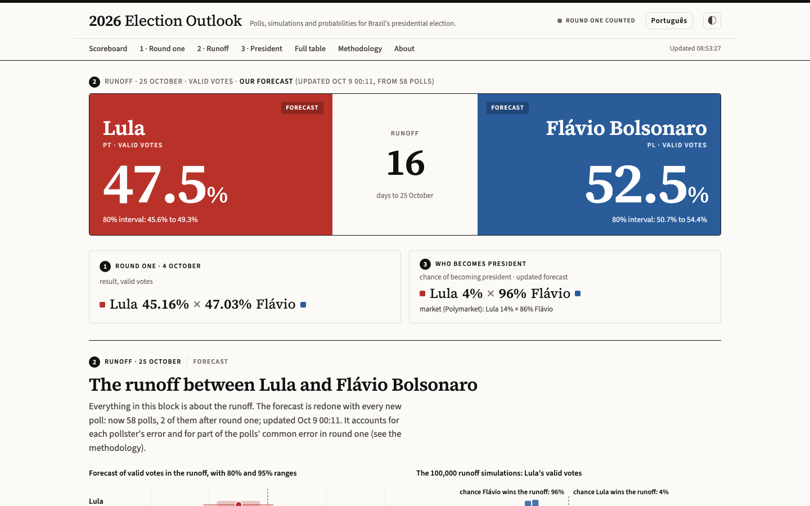
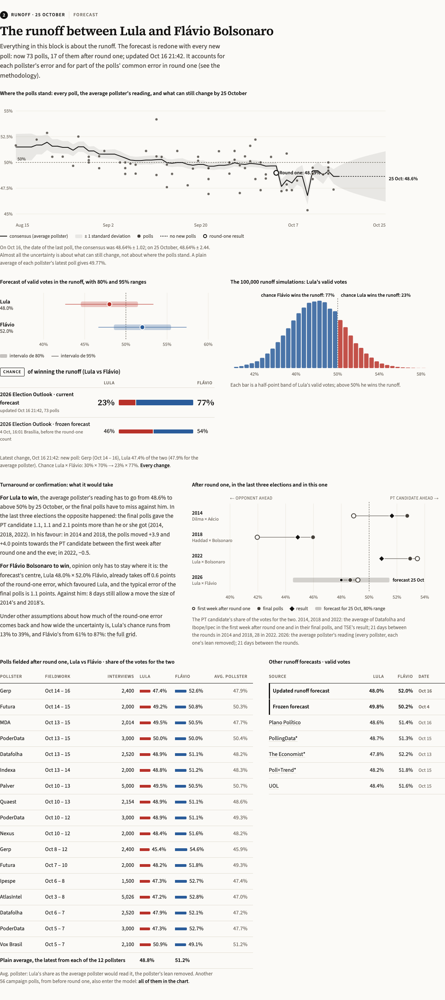
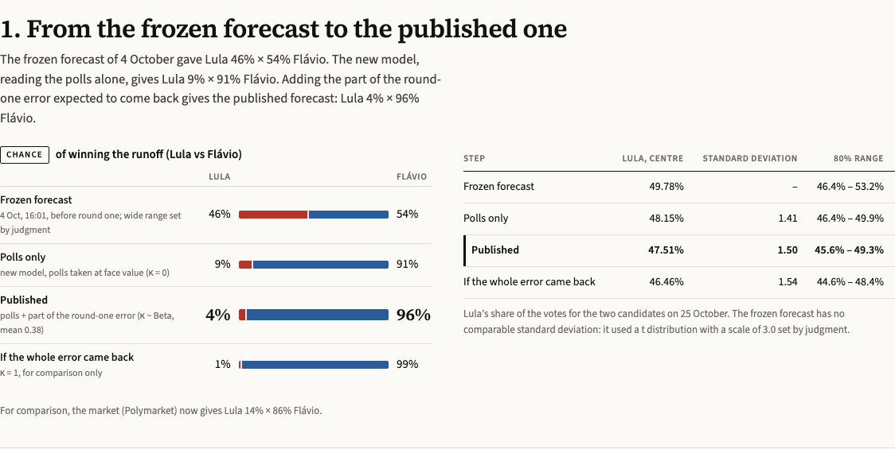
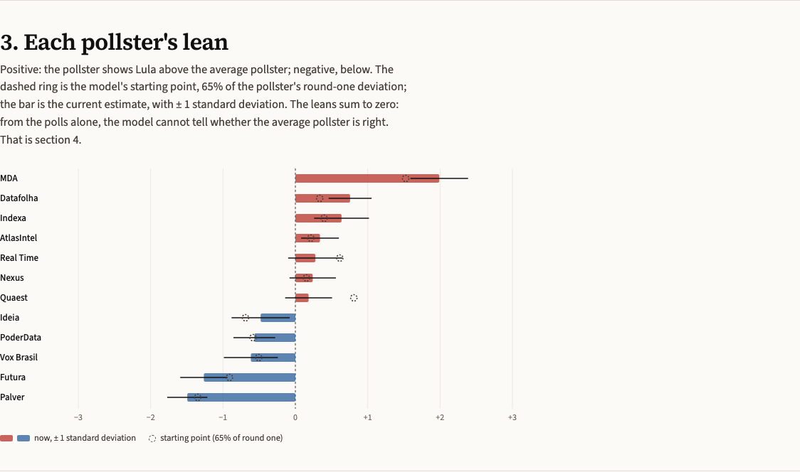
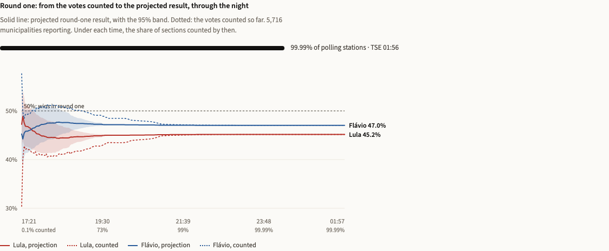
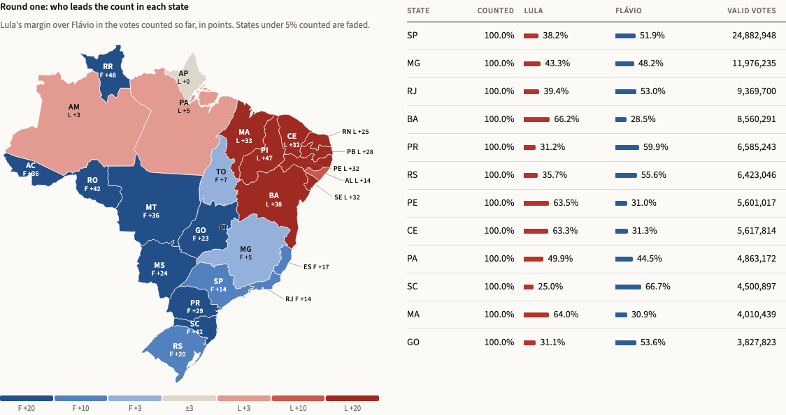
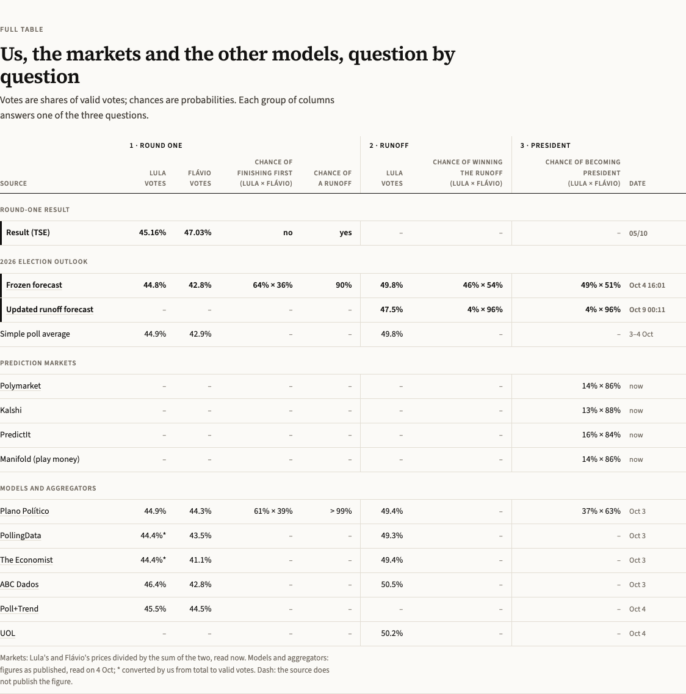

# 2026 Election Outlook

**Deployed product · probabilistic forecasting · state-space model (Kalman filter) · Monte Carlo
simulation · pre-registered evaluation**

A live dashboard and forecast for Brazil's 2026 presidential election, in English and Portuguese:
the forecast, the official count with a projection of the final result, four prediction markets,
the polls and the news on one page. Every forecast is frozen with a date and time before the vote
it predicts and scored in public afterwards. Every chance is shown for both candidates.

**Live: [brelections.tiagodantas.com/en](https://brelections.tiagodantas.com/en)** ·
[Portuguese](https://brelections.tiagodantas.com) ·
[Methodology](https://brelections.tiagodantas.com/en/methodology) ·
[How we got to the current forecast](https://brelections.tiagodantas.com/en/how-we-got-here)

> The source code is in a private repository. This one documents the product: what it does, how
> the models work, how they are scored and how they have done so far.

The dashboard on 9 October 2026, between the two rounds. The live numbers change with each new poll.

## What this project covers

| Area | What was built | Where to see it |
|---|---|---|
| Deployed product | A bilingual dashboard rebuilt every minute from an archive of every response from every source, so any number on it can be reproduced later | [Dashboard](https://brelections.tiagodantas.com/en) |
| Probabilistic forecasting | Round one: poll average with a shared Student-t error, 100,000 simulations. Runoff: a state-space model with pollster house effects, redone whenever a new poll comes in | [Methodology §3](https://brelections.tiagodantas.com/en/methodology) |
| Election-night projection | The final result estimated from the votes already counted, by municipal swing against 2022, updated as the electoral court (TSE) publishes | [Round one on the dashboard](https://brelections.tiagodantas.com/en) |
| Data collection | TSE result files every 30 s, Wikipedia poll tables, the order books of Polymarket, Kalshi, PredictIt and Manifold, news feeds from six outlets and Google News every 5 min | [Methodology §2](https://brelections.tiagodantas.com/en/methodology) |
| Evaluation | Plans written before the forecasts they score; Brier score, log score, absolute error and interval coverage, against the plain poll average and the markets | [Methodology §8](https://brelections.tiagodantas.com/en/methodology) |
| Explaining a probability | Each step from the polls to the published chance, each pollster's lean, a sensitivity grid and a log of every change with its cause | [How we got here](https://brelections.tiagodantas.com/en/how-we-got-here) |

No machine learning, on purpose: an election has a few hundred polls and one outcome. It is a
small-sample problem, and a transparent statistical model with honest uncertainty fits it.

## The models

| Question | Model | Core equations | Set from history or judgment |
|---|---|---|---|
| Round one, frozen 4 Oct, 16:01 Brasília | Unweighted mean of each pollster's latest poll (12 pollsters), plus a shared election-day error | L = L̄ + eL, F = F̄ + eF, (eL, eF) ~ t5(0, σ = 4.0, ρ = −0.2) | σ from the final-poll misses of 2018 and 2022; 100,000 draws, fixed seed |
| Runoff, from 7 Oct | Local-level state-space model, Kalman filter on a daily grid with the pollster effects in the state; drift before round one, extra noise and pollster spread by maximum likelihood at every run | yi = θt + δh + εi · θt = θt−1 + ηt · V = θ25 Oct − (κ·b1 + e) | b1 = 1.7 points, the polls' round-one error on the two-candidate share; κ ~ Beta(1.05, 1.72), mean 0.38, the share of it that comes back; e ~ t5, scale 1.08 points, from the final runoff polls of 2006–2022; each pollster's effect starts at 65% of its round-one effect; from the day after round one, drift fixed at 0.74 points a day, from how far the polls moved after round one in 2014, 2018 and 2022 |
| Count night, 4 Oct | Municipal swing against 2022 in log-odds, pooled by state | logit pm = logit pm2022 + αstate + εm | State swing pulled toward the national one until the state has 200,000 valid votes counted; 2,000 simulations with a shared counting-order shock |
| Who becomes president | Composition of the two rounds | P(president) = P(win round one) + P(runoff) × P(win runoff) | Round-one and runoff errors treated as independent, a simplification the methodology states |

θ is the average pollster's reading of Lula's share of the two-candidate vote, δ each pollster's
lean (the leans sum to zero), ε each poll's sampling error. The page
[How we got here](https://brelections.tiagodantas.com/en/how-we-got-here) takes the current
forecast apart step by step.

## How it is scored, written in advance

- **Round one** was frozen at 16:01 Brasília on 4 October, an hour before the polls closed, as a
  timestamped file under version control.
- **The runoff evaluation plan** was recorded at 17:02 on 7 October, before the first updated
  forecast, and is not edited. Changes go in dated addenda: on 8 October, written before any
  runoff poll fielded after round one, and on 9 October, after two polls moved Lula's chance from
  28% to 4.5% with a band of ±1.5 points. A rule written before the 2014 and 2018 polls were read
  found that band too narrow in two of three elections, so the drift after round one now comes
  from history. With the same polls the chance went from 4.5% to 21.6%; the methodology page gives
  the numbers and the limits of that fix.
- **Scores:** Brier and log score on the winner; absolute error on the vote share; whether the
  result lands in the 80% and 95% ranges.
- **Benchmarks, at the same instants:** the frozen 4 October forecast, the plain average of each
  pollster's latest poll, and the prediction markets.
- **Written down as failure:** the result outside the 95% range; a larger error than the plain
  poll average; a worse Brier score than the markets. The results go on the site on 26 October,
  whatever they are.

## The record so far

Round one, 4 October: the frozen forecast against the TSE count.

| | Forecast · 80% range | Result |
|---|---|---|
| Lula, share of valid votes | 44.8% · 40.3–49.3 | 45.2% |
| Flávio Bolsonaro, share of valid votes | 42.8% · 38.3–47.4 | 47.0% |
| Who finishes first (Lula × Flávio) | 64% × 36% | Flávio |
| Chance of a runoff | 90% | Runoff |

Both shares landed inside the 80% ranges. Lula's was 0.4 points from the centre; Flávio's was 4.2
points above it, in the same direction as the poll misses of 2018 and 2022. The forecast published
that scenario alongside (Flávio 48.1%, Lula 43.1%) but did not apply it, because two elections are
too few to call a bias permanent. On who would finish first it was on the wrong side, as was Plano
Político (61% × 39%), the only other model in the comparison that publishes probabilities.

Known weaknesses, as the methodology page states them:

- The count projection ran uncalibrated on its first night, and its ranges were too narrow late
  on, from about 80% of polling stations counted.
- Back-tested on the 2022 runoff with only what was known before 2022, the runoff model was worse
  than the plain poll average on three of four dates and overconfident: the result fell outside
  its 95% range on two of the four. The share of round-one error it carries over (κ) was
  estimated with 2022 included, so the current version is a bet backed by one election, not
  proven skill.
- The drift after round one comes from three elections, two with large swings; it is probably
  too wide.

The runoff is scored on 26 October.

## Data

| Source | What is used | How often |
|---|---|---|
| TSE result-publication files | National, state and municipal results; sections counted | Every 30 s on count night |
| TSE open data | 2018 and 2022 results by municipality | Once |
| Wikipedia (English), 2026 polling tables | Pollster, fieldwork dates, sample, voting intention | Every 3 h; a poll enters only after two consecutive reads |
| Polymarket, Kalshi, PredictIt, Manifold | Best bid and best ask of each contract; price history | 30 s to 5 min |
| g1, Estadão, Poder360, BBC News Brasil, Correio Braziliense, Agência Brasil, Google News | Headline, outlet, time and link | Every 5 min |

Every response is stored as received, with the time it was collected.

## Built with

Python 3.13 with NumPy, SciPy, pandas and httpx. The Kalman filter and the simulations are written
directly, without a forecasting library. The front end is plain JavaScript, with SVG charts drawn in
code (no chart library) and self-hosted fonts. A Docker service on Railway runs the collectors and the site, with
a volume for the archive.

## Author

Tiago Dantas · [LinkedIn](https://www.linkedin.com/in/tiagomendesdantas)
